# FShot

[繁體中文](https://github.com/codemee/fshot/blob/main/README.md) | [English](https://github.com/codemee/fshot/blob/main/README.en.md)

FShot 是桌面截圖工具，提供全域快捷鍵、系統匣常駐、多頁籤編輯與快速複製／存檔，支援 Windows 與 macOS。

## 支援平台

- Windows 10/11 x64。
- macOS Apple Silicon；不支援 Intel Mac。
- Linux 尚未正式支援。

## Quick Start

### 桌面應用程式

一般使用者建議從 [GitHub Releases](https://github.com/codemee/fshot/releases) 下載：

- Windows 10/11 x64：單一可攜式 `FShot-<版本>-windows-x64.exe`，不需要 Python。
- Apple Silicon Mac：`FShot-<版本>-macos-arm64.dmg`，開啟後將 `FShot.app` 拖入 Applications；不支援 Intel Mac。

首次開啟時，Windows 可能顯示 SmartScreen 提示；macOS 可能需要在「系統設定 → 隱私權與安全性」選擇「仍要打開」，並授予「螢幕錄製」與「輔助使用」權限。安裝步驟、權限設定與檔案校驗方式，請閱讀 [Windows 安裝說明](docs/install-windows.md) 或 [macOS 安裝說明](docs/install-macos.md)。

### 從 PyPI 執行

FShot 可從 [PyPI](https://pypi.org/project/fshot/) 安裝。不需安裝即可使用 `uvx` 執行最新正式版本：

```powershell
uvx fshot
```

第一次執行會從 PyPI 下載套件並建立 uv 快取環境，後續會重用快取。臨時試用建議使用 `uvx`，若要長期使用則安裝為 uv tool。

使用 uv 從 PyPI 安裝：

```powershell
uv tool install fshot
fshot
```

安裝後可直接執行 `fshot`；更新至 PyPI 最新版本：

```powershell
uv tool upgrade fshot
```

使用 `uv tool install` 安裝時，FShot 啟動後會在背景每日檢查一次 PyPI。系統匣選單可手動「檢查更新…」或停用自動檢查；發現新版時可選擇更新並重新啟動、稍後處理或略過該版本。更新前若有尚未儲存的截圖，FShot 會先要求確認。桌面應用程式版則會檢查 GitHub Release，開啟新版下載頁讓你手動更新。`uvx` 使用者會收到手動更新指引。

程式啟動後會隱藏主視窗並留在系統匣。雙擊系統匣圖示可顯示編輯視窗，右鍵選單可退出。

### 工具列圖示與功能

快捷鍵設定、配色與語言按鈕集中在工具列右側，並以群組分隔線與其他工具區隔；窄視窗時仍可透過三點功能表操作。

選取中的狀態按鈕使用 hover 底色與強調色圖示：淺色模式為藍色，深色模式為螢光綠，方便辨識目前啟用的工具與選項。

縮放工具群提供放大、縮小、符合視窗與目前比例；按一下比例即可輸入 1%–800%，按 Enter 或「套用」確認。各標籤頁保留自己的比例，`Ctrl+0` 可回到 100%；縮放僅影響顯示，不改變圖片內容。縮放工具與「包含游標」等擷取設定以分隔線區隔。

下表依工具列由左至右排列，圖示會配合閱讀器的淺色或深色模式顯示。將滑鼠停在按鈕上可查看目前語言的提示與快捷鍵；線條樣式、顏色、延遲及模式圖示會隨設定改變。下列快捷鍵以 Windows 為例。

| 圖示 | 功能 | 操作方式／快捷鍵 |
| --- | --- | --- |
| <picture><source media="(prefers-color-scheme: dark)" srcset="docs/images/toolbar/dark/pen.png"><source media="(prefers-color-scheme: light)" srcset="docs/images/toolbar/pen.png">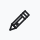</picture> | 自由畫筆 | 在圖片上拖曳繪製自由線條。<kbd>Alt</kbd>+<kbd>P</kbd> |
| <picture><source media="(prefers-color-scheme: dark)" srcset="docs/images/toolbar/dark/line.png"><source media="(prefers-color-scheme: light)" srcset="docs/images/toolbar/line.png">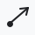</picture> | 線條／箭頭 | 拖曳繪製直線，預設以實心圓起始、箭頭結束。<kbd>Alt</kbd>+<kbd>L</kbd> |
| <picture><source media="(prefers-color-scheme: dark)" srcset="docs/images/toolbar/dark/line_dropdown.png"><source media="(prefers-color-scheme: light)" srcset="docs/images/toolbar/line_dropdown.png">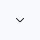</picture> | 線條端點樣式 | 點擊線條按鈕右側的小箭頭，分別設定起點與終點為無、箭頭或實心圓。 |
| <picture><source media="(prefers-color-scheme: dark)" srcset="docs/images/toolbar/dark/rectangle.png"><source media="(prefers-color-scheme: light)" srcset="docs/images/toolbar/rectangle.png">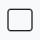</picture> | 矩形 | 拖曳繪製矩形框。<kbd>Alt</kbd>+<kbd>R</kbd> |
| <picture><source media="(prefers-color-scheme: dark)" srcset="docs/images/toolbar/dark/measure.png"><source media="(prefers-color-scheme: light)" srcset="docs/images/toolbar/measure.png">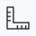</picture> | 丈量像素 | 拖曳顯示橫向、縱向像素差；放開保留讀值，重新丈量或切換工具時清除。讀值不寫入圖片。<kbd>Alt</kbd>+<kbd>D</kbd> |
| <picture><source media="(prefers-color-scheme: dark)" srcset="docs/images/toolbar/dark/text.png"><source media="(prefers-color-scheme: light)" srcset="docs/images/toolbar/text.png"></picture> | 文字 | 在圖片上加入文字。<kbd>Alt</kbd>+<kbd>T</kbd> |
| <picture><source media="(prefers-color-scheme: dark)" srcset="docs/images/toolbar/dark/mosaic.png"><source media="(prefers-color-scheme: light)" srcset="docs/images/toolbar/mosaic.png"></picture> | 馬賽克 | 拖曳選取範圍，以馬賽克遮蔽內容。<kbd>Alt</kbd>+<kbd>M</kbd> |
| <picture><source media="(prefers-color-scheme: dark)" srcset="docs/images/toolbar/dark/rotate_clockwise.png"><source media="(prefers-color-scheme: light)" srcset="docs/images/toolbar/rotate_clockwise.png"></picture> | 順時針旋轉 | 將圖片順時針旋轉 90°。<kbd>Alt</kbd>+<kbd>C</kbd> |
| <picture><source media="(prefers-color-scheme: dark)" srcset="docs/images/toolbar/dark/flip_horizontal.png"><source media="(prefers-color-scheme: light)" srcset="docs/images/toolbar/flip_horizontal.png">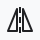</picture> | 水平鏡射 | 將圖片左右翻轉。<kbd>Alt</kbd>+<kbd>H</kbd> |
| <picture><source media="(prefers-color-scheme: dark)" srcset="docs/images/toolbar/dark/flip_vertical.png"><source media="(prefers-color-scheme: light)" srcset="docs/images/toolbar/flip_vertical.png"></picture> | 垂直鏡射 | 將圖片上下翻轉。<kbd>Alt</kbd>+<kbd>V</kbd> |
| <picture><source media="(prefers-color-scheme: dark)" srcset="docs/images/toolbar/dark/resize_down.png"><source media="(prefers-color-scheme: light)" srcset="docs/images/toolbar/resize_down.png">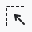</picture> | 縮小圖片 | 開啟面板輸入 1–99%，實際縮小圖片像素尺寸，可復原。<kbd>Alt</kbd>+<kbd>S</kbd> |
| <picture><source media="(prefers-color-scheme: dark)" srcset="docs/images/toolbar/dark/style.png"><source media="(prefers-color-scheme: light)" srcset="docs/images/toolbar/style.png"></picture> | 線寬與顏色 | 開啟面板調整繪圖線寬及顏色，亦可選擇自訂顏色。 |
| <picture><source media="(prefers-color-scheme: dark)" srcset="docs/images/toolbar/dark/undo.png"><source media="(prefers-color-scheme: light)" srcset="docs/images/toolbar/undo.png">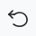</picture> | 復原 | 還原前一次圖片編輯。<kbd>Ctrl</kbd>+<kbd>Z</kbd> |
| <picture><source media="(prefers-color-scheme: dark)" srcset="docs/images/toolbar/dark/copy.png"><source media="(prefers-color-scheme: light)" srcset="docs/images/toolbar/copy.png">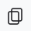</picture> | 複製圖片 | 將目前圖片複製至剪貼簿。<kbd>Ctrl</kbd>+<kbd>C</kbd> |
| <picture><source media="(prefers-color-scheme: dark)" srcset="docs/images/toolbar/dark/save.png"><source media="(prefers-color-scheme: light)" srcset="docs/images/toolbar/save.png">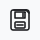</picture> | 存檔 | 儲存目前圖片；已有來源路徑時寫回原檔，新圖片則選擇儲存位置。<kbd>Ctrl</kbd>+<kbd>S</kbd> |
| <picture><source media="(prefers-color-scheme: dark)" srcset="docs/images/toolbar/dark/save_as.png"><source media="(prefers-color-scheme: light)" srcset="docs/images/toolbar/save_as.png">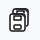</picture> | 另存新檔 | 選擇另一個檔名或位置儲存圖片。<kbd>Ctrl</kbd>+<kbd>Shift</kbd>+<kbd>S</kbd> |
| <picture><source media="(prefers-color-scheme: dark)" srcset="docs/images/toolbar/dark/zoom_in.png"><source media="(prefers-color-scheme: light)" srcset="docs/images/toolbar/zoom_in.png"></picture> | 放大顯示 | 放大編輯器中的圖片顯示，不改變圖片像素尺寸。<kbd>Ctrl</kbd>+<kbd>+</kbd>／<kbd>Ctrl</kbd>+<kbd>=</kbd> |
| <picture><source media="(prefers-color-scheme: dark)" srcset="docs/images/toolbar/dark/zoom_out.png"><source media="(prefers-color-scheme: light)" srcset="docs/images/toolbar/zoom_out.png">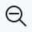</picture> | 縮小顯示 | 縮小編輯器中的圖片顯示，不改變圖片像素尺寸。<kbd>Ctrl</kbd>+<kbd>-</kbd> |
| <picture><source media="(prefers-color-scheme: dark)" srcset="docs/images/toolbar/dark/zoom_fit.png"><source media="(prefers-color-scheme: light)" srcset="docs/images/toolbar/zoom_fit.png">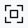</picture> | 符合視窗 | 依目前可用空間調整顯示比例，完整顯示圖片，不改變圖片像素尺寸。 |
| `100%` | 顯示比例 | 顯示目前比例（四捨五入為整數）；按一下可輸入 1%–800%，按 Enter 或「套用」確認。 |
| <picture><source media="(prefers-color-scheme: dark)" srcset="docs/images/toolbar/dark/cursor_off.png"><source media="(prefers-color-scheme: light)" srcset="docs/images/toolbar/cursor_off.png"></picture> <picture><source media="(prefers-color-scheme: dark)" srcset="docs/images/toolbar/dark/cursor_on.png"><source media="(prefers-color-scheme: light)" srcset="docs/images/toolbar/cursor_on.png"></picture> | 擷取時包含游標 | 單擊切換是否將游標加入截圖；有勾號表示啟用。 |
| <picture><source media="(prefers-color-scheme: dark)" srcset="docs/images/toolbar/dark/delay_off.png"><source media="(prefers-color-scheme: light)" srcset="docs/images/toolbar/delay_off.png">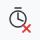</picture> <picture><source media="(prefers-color-scheme: dark)" srcset="docs/images/toolbar/dark/delay_5.png"><source media="(prefers-color-scheme: light)" srcset="docs/images/toolbar/delay_5.png">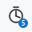</picture> | 延遲擷取 | 開啟面板選擇關閉、1、3、5 秒或自訂 0–60 秒；圖示數字表示目前秒數。虛擬模式的作用中視窗設定延遲後會開啟操作預覽。 |
| <picture><source media="(prefers-color-scheme: dark)" srcset="docs/images/toolbar/dark/screen_physical.png"><source media="(prefers-color-scheme: light)" srcset="docs/images/toolbar/screen_physical.png"></picture> <picture><source media="(prefers-color-scheme: dark)" srcset="docs/images/toolbar/dark/screen_virtual.png"><source media="(prefers-color-scheme: light)" srcset="docs/images/toolbar/screen_virtual.png">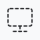</picture> | 實體／虛擬螢幕 | 單擊切換，實線表示實體、虛線表示虛擬，設定會保留。虛擬模式可擷取高解析度視窗；[設定步驟與限制](docs/virtual-screen.md)。 |
| <picture><source media="(prefers-color-scheme: dark)" srcset="docs/images/toolbar/dark/keyboard.png"><source media="(prefers-color-scheme: light)" srcset="docs/images/toolbar/keyboard.png">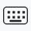</picture> | 設定擷取快捷鍵 | 設定四種擷取模式及重複擷取的 <kbd>Ctrl</kbd>／<kbd>Shift</kbd>／<kbd>Alt</kbd> 加 <kbd>A</kbd>–<kbd>Z</kbd> 組合；<kbd>Shift</kbd> 須搭配 <kbd>Ctrl</kbd> 或 <kbd>Alt</kbd>。按 OK 且註冊成功後套用，Cancel 不變更；「使用預設」重設面板欄位。 |
| <picture><source media="(prefers-color-scheme: dark)" srcset="docs/images/toolbar/dark/theme_system.png"><source media="(prefers-color-scheme: light)" srcset="docs/images/toolbar/theme_system.png"></picture> <picture><source media="(prefers-color-scheme: dark)" srcset="docs/images/toolbar/dark/theme_light.png"><source media="(prefers-color-scheme: light)" srcset="docs/images/toolbar/theme_light.png"></picture> <picture><source media="(prefers-color-scheme: dark)" srcset="docs/images/toolbar/dark/theme_dark.png"><source media="(prefers-color-scheme: light)" srcset="docs/images/toolbar/theme_dark.png"></picture> | 主題 | 單擊循環切換「跟隨系統 → 淺色 → 深色」，並保留選擇；深色採《新世紀福音戰士》初號機風格的紫色與螢光綠配色。圖示依序為半明半暗圓、太陽、月亮。 |
| <picture><source media="(prefers-color-scheme: dark)" srcset="docs/images/toolbar/dark/language_system.png"><source media="(prefers-color-scheme: light)" srcset="docs/images/toolbar/language_system.png"></picture> <picture><source media="(prefers-color-scheme: dark)" srcset="docs/images/toolbar/dark/language_zh_TW.png"><source media="(prefers-color-scheme: light)" srcset="docs/images/toolbar/language_zh_TW.png">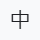</picture> <picture><source media="(prefers-color-scheme: dark)" srcset="docs/images/toolbar/dark/language_en.png"><source media="(prefers-color-scheme: light)" srcset="docs/images/toolbar/language_en.png"></picture> | 語言 | 單擊循環切換「跟隨系統 → 繁體中文 → English」，並保留選擇；圖示依序為地球、中、A。 |

macOS 的復原、複製與存檔使用 <kbd>⌘</kbd> 組合鍵；顯示縮放沿用表列 <kbd>Ctrl</kbd> 組合。貼上、重設縮放、頁籤重新命名及拖曳裁切沒有工具列按鈕，請參閱下方編輯快捷鍵與圖片操作說明。

圖片也可透過拖放或剪貼簿加入編輯器：拖放圖片會以完整檔名建立頁籤、保留來源路徑並在修改後寫回原檔；直接貼上影像或從檔案管理器複製圖片後貼上，會以截圖時間格式建立新的未存檔頁籤。成功存檔後會記住檔案所在資料夾，其他尚未存檔的頁籤會從該資料夾開啟儲存交談窗。Windows/Linux 使用 <kbd>Ctrl</kbd>+<kbd>V</kbd>，macOS 使用 <kbd>⌘</kbd>+<kbd>V</kbd>。

## 虛擬螢幕擷取（實驗功能）

需要高解析度視窗截圖時，可用工具列的螢幕按鈕切換虛擬模式；選擇會保留。此功能需要虛擬顯示器與相應的系統權限。

Windows／macOS 的設定步驟、延遲操作預覽與使用限制，請閱讀 [虛擬螢幕擷取指南](docs/virtual-screen.md)。

## 快捷鍵

- <kbd>Ctrl</kbd>+<kbd>Shift</kbd>+<kbd>Q</kbd>: 重複前一次的截圖方式（矩形區域與選取的視窗／控制項會沿用前次目標，可在設定面板自訂）
- <kbd>Ctrl</kbd>+<kbd>Shift</kbd>+<kbd>A</kbd>: 擷取目前焦點視窗
- <kbd>Ctrl</kbd>+<kbd>Shift</kbd>+<kbd>R</kbd>: 擷取矩形區域
- <kbd>Ctrl</kbd>+<kbd>Shift</kbd>+<kbd>F</kbd>: 擷取全螢幕
- <kbd>Ctrl</kbd>+<kbd>Shift</kbd>+<kbd>W</kbd>: 選取視窗或控制項後擷取

macOS 使用相同的 <kbd>Ctrl</kbd>+<kbd>Shift</kbd> 字母組合。獨立 App 請授權 `FShot.app`；透過 `uv`／`uvx` 執行時，系統設定中的授權對象通常是啟動指令所在的 App，例如「終端機」、iTerm2 或 IDE。授權後請完全結束並重新開啟 FShot 或該宿主 App。

編輯工具快捷鍵：

- <kbd>Alt</kbd>+<kbd>P</kbd>: 自由畫筆
- <kbd>Alt</kbd>+<kbd>L</kbd>: 線條
- <kbd>Alt</kbd>+<kbd>R</kbd>: 矩形
- <kbd>Alt</kbd>+<kbd>D</kbd>: 丈量像素
- <kbd>Alt</kbd>+<kbd>T</kbd>: 文字
- <kbd>Alt</kbd>+<kbd>M</kbd>: 馬賽克
- <kbd>Alt</kbd>+<kbd>C</kbd>: 順時針旋轉 90°
- <kbd>Alt</kbd>+<kbd>S</kbd>: 依比例縮小圖片
- <kbd>Alt</kbd>+<kbd>H</kbd>: 水平鏡射
- <kbd>Alt</kbd>+<kbd>V</kbd>: 垂直鏡射
- <kbd>Ctrl</kbd>+<kbd>+</kbd> / <kbd>Ctrl</kbd>+<kbd>=</kbd>: 放大
- <kbd>Ctrl</kbd>+<kbd>-</kbd>: 縮小
- <kbd>Ctrl</kbd>+<kbd>0</kbd>: 重設縮放
- <kbd>F2</kbd>: 直接在目前標籤頁重新命名已存檔的檔案（macOS 使用 <kbd>Return</kbd>）

已存檔的標籤頁也可直接雙擊名稱進入重新命名；副檔名會保留不變。

### 標籤頁快捷鍵

以下為 Windows／Linux 的操作，僅在編輯視窗內生效：

| 快捷鍵 | 操作 |
| --- | --- |
| <kbd>Ctrl</kbd>+<kbd>Tab</kbd>／<kbd>Ctrl</kbd>+<kbd>Page Down</kbd> | 下一個頁籤，到最後一頁後回到第一頁 |
| <kbd>Ctrl</kbd>+<kbd>Shift</kbd>+<kbd>Tab</kbd>／<kbd>Ctrl</kbd>+<kbd>Page Up</kbd> | 上一個頁籤，到第一頁後回到最後一頁 |
| <kbd>Ctrl</kbd>+<kbd>1</kbd>–<kbd>8</kbd> | 依左至右順序切換到第 1–8 個頁籤 |
| <kbd>Ctrl</kbd>+<kbd>9</kbd> | 最後一個頁籤 |
| <kbd>Ctrl</kbd>+<kbd>W</kbd>／<kbd>Ctrl</kbd>+<kbd>F4</kbd> | 關閉目前頁籤；未儲存時先要求確認 |

macOS 的關閉與數字選頁使用 <kbd>⌘</kbd> 組合鍵，上一頁／下一頁沿用 Qt 平台標準快捷鍵。關閉最後一個頁籤後，編輯視窗仍保持開啟。

關閉頁籤、編輯視窗或結束程式前，若有未儲存變更，會提供「儲存／儲存全部」「不儲存」「取消」。取消存檔或儲存失敗時會保留頁籤，不繼續關閉或更新。關閉編輯視窗後，FShot 仍會留在系統匣。

## 更多說明

- [Windows 安裝與權限](docs/install-windows.md)
- [macOS 安裝與權限](docs/install-macos.md)
- [虛擬螢幕擷取指南](docs/virtual-screen.md)

參與開發請閱讀 [開發指南](docs/development.md)，其中包含架構、跨平台與打包文件的入口。
